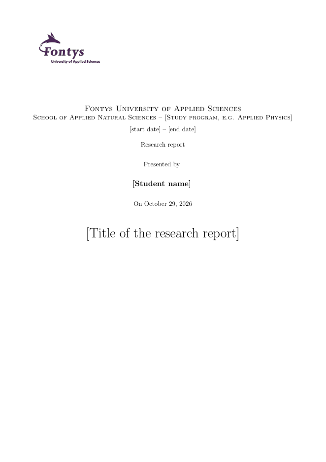

# LaTeX template for a Fontys research report (SA5)

An unofficial LaTeX template for an (graduation) internship report at Fontys University of Applied Sciences, School of Applied Natural Sciences. The structure follows the Fontys assessment form for the report (SA5): cover, title page, summary in English and Dutch, preface, table of contents, introduction, theory, method, results, discussion, conclusion, recommendations, bibliography in IEEE style, and appendices.

*Nederlands: een onofficieel LaTeX-template voor een (afstudeer)stageverslag bij Fontys Toegepaste Natuurwetenschappen, opgebouwd volgens het beoordelingsformulier SA5. Gebruik: zie hieronder.*

  

Prefer Typst over LaTeX? See [TomVer99/Fontys-paper-template](https://github.com/TomVer99/Fontys-paper-template), a general Fontys paper template for Typst.

## Disclaimer

- This template is not endorsed by, affiliated with, maintained, authorised or sponsored by Fontys University of Applied Sciences (Fontys Hogeschool). It was made by a student for their own report and is shared in the hope that it is useful to others.
- It is provided as-is, without any warranty (see `LICENSE`). Use it at your own risk.
- The requirements for a report can differ per programme and change over time. Always check the current assessment form and guidelines of your own programme, and ask your supervisor when in doubt. Following this template does not guarantee that a report meets the requirements.
- The Fontys logo (`Figures/99_Logos/Fontys Logo.png`) is the property of Fontys. It is included unchanged, only so that a Fontys report can be made with it, and it is not covered by the MIT license. See `Figures/99_Logos/NOTICE` for where Fontys publishes the conditions for using its logo.
- Appendix A contains an example statement on the use of AI tools. Adapt it to what you actually did, and check what your programme requires.

## Use

1. Download the repository as a zip (*Code → Download ZIP*) and upload it to Overleaf: *New Project → Upload Project*. Any other LaTeX installation works too.
2. Fill in `metadata.tex` once. The front page and the info page take everything from there. A company logo can be set with `\companyLogo`.
3. Write in the files in `Sections/` and `Appendices/`. Each chapter starts with a comment saying what Fontys expects there.
4. Before submitting, set `\notesfalse` at the top of `main.tex`: all `\todo` notes disappear.

Compiler: pdfLaTeX with BibTeX (the Overleaf default).

## What the template does

- Page numbering as Fontys asks: roman numerals before the introduction, arabic from chapter 1, and each appendix numbered on its own (A-1, B-1, …).
- References in IEEE style, numbered in order of citation (`IEEEtran`). Examples of common source types are in `template_bib.tex`. `bibliography.bib` contains one example entry, cited once in the theory chapter; remove both when you add your own sources.
- `\fig{path}{width}{caption}{label}` includes a figure, or draws a placeholder frame if the file does not exist yet, so the report always compiles.
- Optional packages (units, sub-figures, pseudocode, …) are listed in `thesisreport.cls`; uncomment what you need.
- The Fontys page limit (max. 35 pages from the introduction up to and including the bibliography) is noted in `main.tex`.

## Files

| File | Content |
|---|---|
| `main.tex` | Order of the parts, the notes switch, `\fig` |
| `metadata.tex` | Title, dates, student, company, supervisors |
| `thesisreport.cls` | Layout: margins, chapter style, page style, packages |
| `frontpage.tex`, `infopage.tex` | Cover and title page (no need to edit) |
| `Sections/` | Summary/Samenvatting, Preface, chapters 1–7 |
| `Appendices/` | Appendix A (example AI statement), B, C |
| `bibliography.bib`, `template_bib.tex` | Sources, and examples per source type |
| `Figures/99_Logos/` | Fontys logo and its `NOTICE` |
| `img/cover.png` | Picture of the front page, for this README |

## Contributing

Found a mistake, or does your programme ask for something the template does not do? Open an issue or a pull request.

## License

The template code is licensed under the MIT License (see `LICENSE`). The Fontys logo is excluded from this license.
